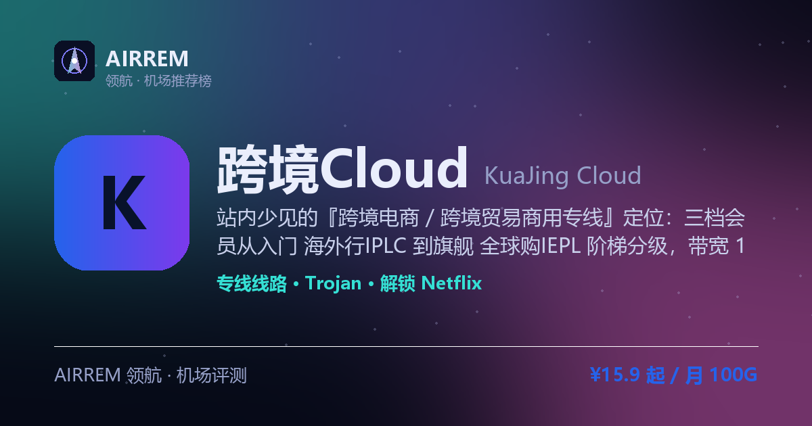

# 跨境Cloud机场怎么样？2026 实测：跨境电商 / 商用出海专线

> 站内少见的『跨境电商 / 跨境贸易商用专线』定位：三档会员从入门 海外行IPLC 到旗舰 全球购IEPL 阶梯分级，带宽 100→1200Mbps 明标、七大洲原生 IP，Trojan 加密专线登录多国店铺后台更稳；月付 ¥15.9/100G 起，还能解锁 Netflix/HBO/Disney+ 与 ChatGPT/Gemini AI 专属节点。
>
> 最适合：**跨境电商 / 商用出海专线**。

👉 **[跨境Cloud 官网注册入口](https://s.rtxk.us/s/4dhmqvu)** ｜ [完整评测与横向对比](https://555736.xyz/kuajing/)

---

## 基本信息

| 项目 | 内容 |
| --- | --- |
| 机场名称 | 跨境Cloud（跨境云 · 跨境电商专线 · KuaJing Cloud） |
| 成立时间 |  |
| 线路类型 | 全系 IPLC/IEPL 专线（三档会员分级） |
| 支持协议 | Trojan |
| 流媒体解锁 | Netflix / HBO / Disney+ / ChatGPT / Gemini |
| 节点地区 | 全球多国、七大洲原生 IP（跨境电商 / 跨境贸易专线专属） |
| 计费方式 | 月付 / 季付 / 半年 / 年付（三档会员分级） |
| 起步价格 | ¥15.9 / 月 100G |
| 推荐场景 | 跨境电商 / 跨境贸易出海办公，要商用级 IPLC/IEPL 专线稳定登录多国店铺后台，顺带解锁 Netflix/HBO/ChatGPT |

## 优点与缺点

**✅ 优点**

- 站内少见的『跨境电商 / 跨境贸易商用专线』定位：面向出海办公、多国店铺后台，不是单纯追剧口粮
- 三档会员阶梯分级（海外行IPLC / 跨境通IEPL / 全球购IEPL），价格、流量、带宽 100→1200Mbps、设备数一目了然，按需选档
- 全系 IPLC/IEPL 专线 + 七大洲原生 IP、AI 多线智能负载，晚高峰与跨境登录稳定优先
- 解锁面广：Netflix / HBO / Disney+（HBO 较少见）+ ChatGPT / Gemini AI 专属节点，桌面移动全平台客户端
- 官网支持免费试用，可先测三网晚高峰再决定

**⚠️ 缺点**

- 公开第三方独立实测偏少、团队 / 老板信息不透明，属于需谨慎观察的机场
- 官网托管在 GitHub、多域名切换，新手找官网 / 订阅有一点门槛，需认准官方渠道防山寨
- 主打专线 + 商用定位，单价比普通中转口粮机场高，入门 100G 也要 ¥15.9/月
- 机场行业普遍有跑路风险，先免费试用 + 月付小额验证，别一上来就大额年付

## 跨境Cloud 是什么

跨境Cloud（又称跨境云，英文常写 KuaJing Cloud）是一家把定位压在「跨境电商 / 跨境贸易商用出海」上的专线机场，官网托管在 GitHub、支持注册后免费试用。和站内多数主打追剧 / 口粮的机场不同，它面向的是要稳定登录亚马逊、TikTok、独立站等多国店铺后台的跨境从业者。

最有辨识度的一点是三档会员阶梯：入门『海外行IPLC』、进阶『跨境通IEPL』、旗舰『全球购IEPL』，价格、流量、带宽、设备数一档档往上给，花多少钱买多大规格一目了然；全线走 IPLC/IEPL 专线传输 + 七大洲原生 IP，商用出海把稳定性放在第一位。

## 线路与会员分级（全系 IPLC/IEPL 专线）

跨境Cloud 全系走专线：入门档为 IPLC 专线，进阶与旗舰档升级为 AI 多线智能负载的 IEPL 加密专线，数据走内网专线传输、延迟低、晚高峰不易拥堵，落地覆盖全球多国、号称七大洲原生 IP。

- 海外行IPLC：¥15.9/月 100G、100Mbps、3 设备（IPLC 专线入门口粮）
- 跨境通IEPL：¥25.9/月 200G、200Mbps、5 设备（IEPL 加密专线主力）
- 全球购IEPL：¥49.9/月 400G、1000Mbps、8 设备（IEPL 旗舰，带宽拉满）
- 长周期加量：季 / 半年 / 年付流量翻倍，半年起带宽提到 120→1200Mbps、设备加至 4→10 台

> 💡 『七大洲原生 IP』『AI 多线智能负载』为官方宣传口径，实际节点数与解锁以购买后面板为准；建议先用免费试用验证自身线路晚高峰。

## 协议与客户端

跨境Cloud 采用 Trojan 系「安全多级跨境协同协议」，兼容主流客户端，桌面与移动全平台都可用；把订阅链接导入 Clash / mihomo 内核客户端（Clash Verge、FlClash、Karing 等）即可使用。

> 💡 官网有直连域名（国内可直接打开）与需代理访问的全球域名；订阅格式与在售协议以官网面板实际下发为准，找官网请认准官方渠道、当心同名山寨站。

## 解锁与 AI 专属节点

解锁上，跨境Cloud 覆盖 Netflix、HBO、Disney+ 等主流流媒体（HBO 在同类机场里较少见），并为 ChatGPT、Gemini 等 AI 工具提供人工 + AI 专属节点，配合原生 IP，跨境电商注册 / 登录各类海外平台也更稳。

- 流媒体：Netflix、HBO、Disney+
- AI：ChatGPT、Gemini 专属节点
- 跨境电商 / 跨境贸易专线专属，登录多国店铺后台更稳

## 跨境Cloud 套餐价格

| 套餐 | 价格 | 说明 |
| --- | --- | --- |
| 海外行IPLC · 月付 | ¥15.9 | 月付 · +100G / 30天重置 · IPLC 专线 · 100Mbps · 3 设备 · 七大洲原生IP |
| 跨境通IEPL · 月付 | ¥25.9 | 月付 · +200G / 30天重置 · IEPL 加密专线 · 200Mbps · 5 设备 · 七大洲原生IP |
| 全球购IEPL · 月付 | ¥49.9 | 月付 · +400G / 30天重置 · IEPL 加密专线 · 1000Mbps · 8 设备 · 七大洲原生IP |
| 海外行IPLC · 年付 | ¥190.8 | 年付 · +1200G / 365天重置 · IPLC 专线 · 120Mbps · 4 设备（半年起带宽/设备升级） |
| 跨境通IEPL · 年付 | ¥310.8 | 年付 · +2400G / 365天重置 · IEPL 加密专线 · 400Mbps · 6 设备（半年起升级） |
| 全球购IEPL · 年付 | ¥598.8 | 年付 · +4800G / 365天重置 · IEPL 加密专线 · 1200Mbps · 10 设备（半年起升级） |

> 三档会员均可选 月付 / 季付 / 半年 / 年付：月付流量为 100/200/400G，季付≈×3、半年≈×6、年付≈×12 按周期重置；带宽与设备数随周期提升——半年 / 年付起，海外行→120Mbps·4 设备、跨境通→400Mbps·6 设备、全球购→1200Mbps·10 设备。季付参考价 海外行 ¥47.5 / 跨境通 ¥76.5 / 全球购 ¥148.5，半年 ¥95.1 / ¥155.1 / ¥299.1。均为专线加密线路，价格与在售套餐以官网实时为准。

## 常见问题

**Q：跨境Cloud 是专门做跨境电商的机场吗？**

A：是。它的定位就压在「跨境电商 / 跨境贸易专线专属」上，全系走 IPLC/IEPL 专线 + 七大洲原生 IP，主打稳定登录多国店铺后台与出海办公，和站内多数追剧 / 口粮机场不同。如果你只是日常刷视频，可看站内更便宜的口粮机场。

**Q：海外行IPLC、跨境通IEPL、全球购IEPL 三档怎么选？**

A：海外行IPLC 是 IPLC 专线入门档（¥15.9/月 100G、100Mbps、3 设备），适合轻量试水；跨境通IEPL 升级为 IEPL 加密专线（¥25.9/月 200G、200Mbps、5 设备），是主力档；全球购IEPL 旗舰（¥49.9/月 400G、1000Mbps、8 设备）带宽拉满、适合多设备重度或多店铺运营。拿不准先月付低档 + 免费试用验证，再升档或转长周期。

**Q：跨境Cloud 官网在哪、会不会跑路？**

A：它官网托管在 GitHub、并有直连与全球多域名，找官网请认准官方渠道、当心同名山寨站。目前公开独立实测偏少、团队信息不透明，稳妥做法是先用免费试用 + 月付小额验证晚高峰与解锁，别一上来就大额年付，并再备一两家机场容灾。

## 适合谁 / 不适合谁

| 👍 适合 | 👎 不适合 |
| --- | --- |
| 做跨境电商 / 跨境贸易、要稳定登录亚马逊 / TikTok / 独立站等多国店铺后台的出海从业者 | 只想要几块钱口粮、对价格极敏感的纯日常用户 |
| 看重 IPLC/IEPL 专线稳定性、愿意按会员档位付费的商用用户 | 要长期第三方实测口碑、只认老牌大站的保守用户 |
| 想顺带解锁 Netflix / HBO / Disney+ 与 ChatGPT / Gemini 的用户 | 要原生一键客户端、零配置开箱即用的纯小白 |
| 喜欢价格 / 带宽 / 设备阶梯明标、按需选档的用户 |  |

## 我们的结论

跨境Cloud 是一家把定位压在『跨境电商 / 跨境贸易商用出海』上的专线机场，官网托管在 GitHub、支持注册后免费试用。它把套餐做成三档会员阶梯：入门 海外行IPLC（¥15.9/月 100G、100Mbps、3 设备）走 IPLC 专线；跨境通IEPL（¥25.9/月 200G、200Mbps、5 设备）与旗舰 全球购IEPL（¥49.9/月 400G、1000Mbps、8 设备）走 AI 多线智能负载的 IEPL 加密专线，带宽随档位 100→1200Mbps 明标、七大洲原生 IP，配 Trojan 协议与全平台客户端，日常还能解锁 Netflix/HBO/Disney+ 和 ChatGPT/Gemini。适合要稳定登录多国店铺后台、看重商用出海的跨境从业者；但它公开第三方实测偏少、团队信息不透明，先用免费试用 + 月付小额验证晚高峰再考虑长约，别一上来就大额年付。

## 同类机场推荐

拿不定主意？可以再看看这几家同类型的：

- **[西部数据](https://555736.xyz/westdata/)** — 稳定专线党，¥17 起
- **[糖果云](https://555736.xyz/candycloud/)** — 影视追剧旗舰，¥18 起
- **[红杏云](https://555736.xyz/hongxing/)** — 流媒体 / 大流量性价比，¥20 起

全部 38 家机场的横向对比与选购方法论：**[信号塔 SignalTower · 机场大全](https://555736.xyz/airports/)**

---

数据更新：2026-07 ｜ 价格、套餐与优惠码以官网实时为准 ｜ 本仓库为第三方评测整理，与 跨境Cloud 官方无隶属关系 ｜ 请遵守当地法律法规使用网络服务。

关键词：跨境Cloud、跨境cloud机场、跨境云、跨境Cloud怎么样、跨境Cloud靠谱吗、跨境Cloud官网、跨境Cloud评测、跨境Cloud优惠码、跨境Cloud注册、跨境Cloud跑路、跨境Cloud套餐、KuaJing Cloud、跨境电商机场、跨境电商专线、跨境贸易专线、商用出海机场、IPLC专线机场、IEPL专线机场、七大洲原生IP、Trojan机场、HBO解锁、机场推荐、机场评测、科学上网、翻墙机场、Clash订阅、Netflix解锁、Disney+解锁、ChatGPT机场
